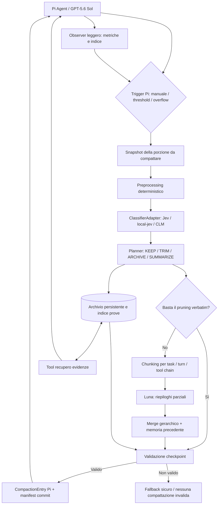

# Pi Context Pipeline — specifica iniziale di un sistema di compattazione gerarchica, selettiva e recuperabile

**Tipo di documento:** vision, analisi dei requisiti, architettura candidata e piano sperimentale  
**Stato:** proposta tecnica da validare; **non** descrive un'estensione già realizzata  
**Versione del documento:** 0.1 — 14 ottobre 2026  
**Ambito:** Pi Agent / harness Pi utilizzato per sviluppo software e sessioni di lavoro molto lunghe  
**Destinatari:** autore dell'harness, futuri collaboratori e agenti incaricati della ricerca e dell'implementazione

> **Idea centrale in una frase:** costruire **una sola estensione Pi**, controllata e versionata da noi, che al momento della compattazione selezioni le informazioni da mantenere tramite un classificatore rapido, archivi gli output originali in forma recuperabile, consolidi gerarchicamente la memoria con un modello separato (inizialmente GPT-5.6 Luna tramite IBM), verifichi il checkpoint e faccia riprendere il modello principale senza perdere i vincoli operativi.

---

## 0. Guida alla lettura e livello delle affermazioni

Questo documento è volutamente una **base di progettazione** e non un piano di modifiche immediatamente approvato. L'obiettivo è rendere espliciti requisiti, assunzioni, criticità ed esperimenti, prima di scrivere codice produttivo.

Le indicazioni sono marcate, dove utile, come:

- **[VERIFICATO]** — comportamento attestato dalla documentazione o dai repository pubblici consultati il 14 ottobre 2026; prima dell'implementazione controllare comunque i commit e le versioni effettivamente installate.
- **[SCELTA PROGETTUALE]** — decisione proposta per il nostro sistema, non funzionalità già presente in Pi.
- **[IPOTESI DA TESTARE]** — proposta plausibile che necessita di benchmark, test su sessioni reali o verifica dell'API effettiva.
- **[DA VERIFICARE IN LOCALE]** — dipende da repository, hardware, override, policy o credenziali disponibili nel tuo ambiente.

Nelle citazioni finali sono disponibili i collegamenti alle fonti primarie. I costi, le disponibilità dei modelli e il codice dei repository possono cambiare.

## 1. Contesto: perché nasce il progetto

### 1.1 Il problema ricorrente con l'auto-compaction

L'harness Pi viene usato per sessioni di sviluppo complesse: letture di file lunghi, interventi su codice, ricerche in repository, numerose chiamate ai tool, subagent, verifiche e revisioni iterative. Il contesto cresce fino a richiedere la compattazione automatica o manuale.

In una precedente sessione è stato osservato il seguente errore:

```text
Auto-compaction failed: Turn prefix summarization failed:
generation hit the token cap and the summary is incomplete

Context overflow recovery failed:
Turn prefix summarization failed:
generation hit the token cap and the summary is incomplete
```

Il problema non riguarda semplicemente un contesto di input troppo grande: **una richiesta di riassunto può raggiungere il proprio limite di output senza aver prodotto un risultato completo**. Pi rifiuta giustamente di considerare valido un riassunto interrotto, ma il lavoro può rimanere bloccato, specialmente quando fallisce anche la procedura di recupero dopo un overflow.

Sono già stati analizzati e/o discussi interventi ai budget di compattazione; tuttavia non è confermato quali valori siano oggi applicati effettivamente. Prima di cambiare impostazioni occorre leggerle dall'ambiente, considerando gli override di progetto e quelli per modello.

### 1.2 Perché il caso «turn prefix» è particolarmente delicato

Un singolo turno dell'agente può contenere molte sequenze `assistant → tool → result → assistant`. Se Pi deve dividere quel turno per lasciare gli eventi recenti, può dover generare un **riepilogo del prefisso del turno** oltre al riepilogo generale della cronologia. Nel codice della famiglia Pi in esame i due budget sono distinti:

- riepilogo ordinario: limite teorico di output fino a `floor(0,8 × reserveTokens)`;
- riepilogo del prefisso del turno: fino a `floor(0,5 × reserveTokens)`;
- entrambi sono limitati anche dal massimo output del modello scelto.

Sono rapporti **dell'implementazione verificata**, non garanzie di qualità o quantità del riepilogo. Il modello, il provider, il reasoning e il modo in cui vengono fatturati/contati i token di ragionamento possono incidere sull'output disponibile. La modalità `xhigh` del modello principale non è necessariamente appropriata per una sintesi.

**Precisazione importante rispetto alle ipotesi iniziali:** nella documentazione Pi attuale, il serializzatore usato dalla compattazione standard **omette i blocchi di thinking** e **tronca i risultati dei tool a 2.000 caratteri** nel testo inviato al summarizer. Quindi non è corretto presumere che la compattazione nativa invii sempre tutte le mille righe di un `read` al modello di riepilogo. Tuttavia la cronologia di lavoro è ampia, contiene molti eventi, e la sintesi può perdere la relazione fra risultati, decisioni e stato corrente. Questi aspetti sono comunque motivazioni valide per una pipeline specializzata. [S1, S2]

### 1.3 Secondo problema: costo e qualità del contesto

Anche quando la compattazione riesce, possono rimanere criticità:

1. **Ridondanza:** gli output di `read`, `bash`, `grep`, test e ricerche possono ripetere dati già utilizzati.
2. **Obsolescenza:** un risultato può essere stato superato da una modifica o da un test successivo.
3. **Perdita semantica:** riassumere un riassunto, più volte, può eliminare vincoli, decisioni, ragioni dei cambiamenti e problemi ancora aperti.
4. **Costo ricorrente:** il contesto mantenuto viene riletto dal modello; anche con la prompt cache, la dimensione incide sull'efficienza.
5. **Continuità operativa:** dopo una compattazione l'agente potrebbe ripetere test già eseguiti, modificare file sbagliati, dimenticare preferenze o contraddire scelte già prese.
6. **Recuperabilità:** un riepilogo non è un sostituto della prova originale; bisogna poter rivedere l'output, il comando o la porzione di file da cui una decisione deriva.

Il progetto deve affrontare **sia il fallimento tecnico della compattazione, sia la qualità del contesto preservato**.

### 1.4 Ambiente e vincoli noti

- Modello principale attuale discusso: `codex-azienda-1000/gpt-5.6-sol`, endpoint IBM compatibile con Azure/OpenAI Responses.
- Modello preferito per il riepilogo: **GPT-5.6 Luna** disponibile, secondo quanto riferito, sullo stesso catalogo IBM; accesso, identificativo esatto, limiti e condizioni vanno verificati.
- Computer di riferimento: **Lenovo ThinkPad P1, 32 GB di RAM**. **Non** è un Mac. GPU, VRAM, generazione del P1, sistema operativo effettivo e WSL2 vanno rilevati; non assumere disponibilità CUDA o Apple Silicon.
- Uso di repository e possibili dati aziendali: le invocazioni di servizi esterni devono rispettare le relative policy. Un prezzo basso non sostituisce l'autorizzazione al trattamento dei dati.
- Si vuole una **singola estensione Pi visibile all'harness**, e non tre estensioni concorrenti che registrino indipendentemente gli stessi hook.
- Si vuole mantenere il progetto **Git-versionato** e predisposto al riuso e, in futuro, alla pubblicazione.

---

## 2. Visione e principi progettuali

### 2.1 Obiettivo funzionale

Quando Pi deve compattare la propria cronologia, il sistema dovrebbe:

1. raccogliere in modo affidabile la porzione di contesto che Pi intende sostituire;
2. **non distruggere alcuna evidenza**: salvare gli originali necessari in archivio persistente con identificatori recuperabili;
3. rimuovere o comprimere deterministicamente la ridondanza ovvia;
4. chiedere a un **classificatore rapido** quali output siano ancora necessari in forma integrale, con categorie più utili di un semplice sì/no;
5. conservare verbatim i passaggi insostituibili (vincoli, errori rilevanti, comandi, patch, risultati decisivi);
6. suddividere il resto in blocchi e farli sintetizzare da **Luna** con un budget controllato;
7. consolidare i riepiloghi parziali insieme alla memoria precedente, preservando il loro legame alle fonti;
8. validare il nuovo checkpoint e la capacità di riprendere il lavoro;
9. **pubblicare** il checkpoint solo se la procedura è riuscita; altrimenti utilizzare una strategia di fallback sicura.

### 2.2 Principi non negoziabili

- **Un unico proprietario del lifecycle di compattazione.** Un solo handler orchestratore gestisce `session_before_compact` e il risultato finale, evitando competizione fra estensioni.
- **Compattare non significa cancellare.** Il modello vede una forma ridotta; i dati originali devono rimanere rintracciabili.
- **Segnali probabilistici, decisioni protette deterministicamente.** Un classificatore può proporre, ma non deve superare i vincoli di conservazione.
- **Verificabilità.** Ogni decisione di pruning deve poter essere spiegata con regola, punteggio, soglia e riferimento alla fonte.
- **Fallback senza perdita.** Qualsiasi errore non deve lasciare un archivio incoerente o un riassunto troncato spacciato per valido.
- **Separazione dei modelli.** Il modello principale resta responsabile del task; classificatore e summarizer lavorano su incarichi limitati.
- **Misurabilità.** I benefici devono essere quantificati rispetto alla compattazione nativa, non presunti.
- **Compatibilità progressiva.** Gli upstream possono evolvere; il nostro codice utilizza adapter, contratti e test di compatibilità.
- **Controllo della privacy.** L'invio remoto è esplicito e governato da una policy, non un effetto collaterale nascosto.

### 2.3 Cosa NON è previsto nel primo MVP

- Non cambiare il modello principale o il suo reasoning.
- Non modificare direttamente il core di Pi o mantenere un fork di Pi, salvo prova concreta di necessità.
- Non fare pruning attivo dopo ogni tool call.
- Non usare CLM-8B in produzione senza un benchmark locale e una valutazione della VRAM.
- Non sostituire tutte le memorie e gli strumenti di ricerca dell'agente.
- Non introdurre un database distribuito, servizi cloud aggiuntivi o vettorializzazione dei repository se non emerge un bisogno reale.
- Non garantire «zero perdita di informazione» sul piano semantico: è un obiettivo da misurare e mitigare, non una promessa matematica.
- Non rendere automatici gli aggiornamenti upstream direttamente in produzione.

---

## 3. Ricerca sulle soluzioni esistenti: cosa riusare

Il sistema non va costruito da zero se esistono componenti affidabili. Le tre sorgenti principali sono le seguenti.

### 3.1 `pi-fast-compaction` — motore di selezione e riduzione

**Repository:** https://github.com/tvdavies/pi-fast-compaction  
**Licenza dichiarata:** MIT. [S3]

**[VERIFICATO]** Intercetta `session_before_compact` e implementa una pipeline che:

1. rappresenta il vecchio contesto in uno stato compatto con messaggi, chiamate ai tool, argomenti, estratti iniziali e dimensione degli output;
2. invia a **Jev** una domanda per ciascun risultato di tool: serve ancora l'output completo per proseguire?;
3. riduce gli output con punteggio sotto soglia, preservando almeno chiamata e argomenti;
4. adatta il contenuto a un budget massimo;
5. se la riduzione è sufficiente, conserva una trascrizione selettiva **verbatim**, evitando una chiamata LLM;
6. se la riduzione è insufficiente, richiama un modello di riepilogo configurabile;
7. in assenza di Jev, prova il summarizer; quando neppure questo è disponibile, può lasciare lavorare Pi nativamente.

Questa estensione fornisce il **pattern di classificazione, fitting, scelta del percorso fast/hybrid e fallback**. Non assumere che produca già l'archivio persistente e recuperabile che desideriamo; questo deve essere aggiunto o ricavato da `pi-condense`.

**Possibili elementi da riusare:** rappresentazione dello stato, client Jev, regole di protezione, scoring e fitting, metriche di evizione, supporto `dry-run`, timeout, tetto di spesa, fallback al summarizer.

**Da verificare prima del riuso:** qualità e test del codice, export realmente riutilizzabili, condizioni della licenza, scelta delle soglie, copertura dei tool personalizzati e gestione degli output multimodali. Il benchmark molto favorevole riportato nel README è un esempio del maintainer, **non** una misura sul nostro workload.

### 3.2 `pi-condense` — due livelli di memoria e recupero degli originali

**Repository:** https://github.com/jjuraszek/pi-condense  
**Licenza dichiarata:** MIT. [S4]

**[VERIFICATO]** Il progetto riduce il contesto attivo sostituendo batch completi di risultati dei tool con riferimenti brevi, mentre gli originali restano recuperabili tramite `context_tree_query`. Descrive esplicitamente la distinzione fra:

- **hot context:** contenuto conciso normalmente passato al modello;
- **cold storage / originale:** contenuto completo recuperabile su richiesta.

Il suo design evita il pruning ad ogni turno perché può invalidare la **prompt cache**. Privilegia batch di lavoro conclusi, deduplicazione per contenuto, archiviazione di risultati particolarmente grandi, protezione di tool/percorsi e compressione delle catene vecchie. [S4]

**Possibili elementi da riusare:** struttura degli identificativi, archivio e lookup, `context_tree_query` o analogo `memory_recall`, gestione dei risultati multimodali, deduplicazione, alias fra copie identiche, cache-aware batching, protezione degli originali.

**Da verificare:** in quale misura l'archivio usa la sessione Pi originale oppure file sidecar; che cosa succede in caso di session switch, branch, cancellazione, crash, aggiornamento; stabilità degli identificativi e modalità di migrazione. È necessario evitare che una dipendenza dall'ordine degli eventi renda inaccessibili dati vecchi.

### 3.3 `pi-observational-memory` — osservazioni, riflessioni e continuità

**Repository:** https://github.com/elpapi42/pi-observational-memory  
**Licenza dichiarata:** MIT. [S5]

**[VERIFICATO]** Implementa memoria incrementale orientata ai fatti:

- **observations:** fatti osservabili della sessione (decisioni prese, test falliti, cambi di piano, file modificati, blocchi);
- **reflections:** conoscenza più durevole distillata dalle osservazioni, utile attraverso più compattazioni o giornate di lavoro;
- recupero delle evidenze originali associate alle osservazioni, dove disponibile.

**Nota importante, ottobre 2026:** il progetto segnala il passaggio alla **V3**, con incompatibilità rispetto a impostazioni e formato di memoria V2; il branch di sviluppo potrebbe contenere modifiche non ancora rilasciate. Quindi è essenziale fissare una versione stabile e studiare la migrazione. [S5]

**Possibili elementi da riusare:** schemi osservazioni/riflessioni, riferimento alla prova, merge incrementale, protezione delle decisioni persistenti, osservazioni pronte per compattazione, modello dedicato e metriche di copertura.

**Da NON duplicare:** un secondo archivio indipendente con identificativi incompatibili, un ulteriore trigger automatico che compatti di propria iniziativa, o un altro summarizer parallelo. Nel progetto nuovo tutti questi compiti devono convergere nell'unico orchestratore.

### 3.4 `context-manager` — riferimento, non dipendenza iniziale

**Repository citato nella discussione:** https://github.com/lantisprime/pi-extensions/tree/main/context-manager  
**Ruolo:** studio di pattern avanzati per osservazione, score, shaping, verifica e telemetria.

**[SCELTA PROGETTUALE]** Per ora rimane fuori dalle dipendenze. Si possono valutare idee, non importare l'intero sistema. La disponibilità esatta del percorso, gli export e la licenza effettiva vanno controllati nel commit scelto prima di qualsiasi riuso di codice.

### 3.5 Tabella di responsabilità unica

| Responsabilità | Base da studiare | Proprietario nel nostro progetto |
|---|---|---|
| Hook compattazione | Pi + fast-compaction | `PiLifecycleAdapter` |
| Preprocessing e scelte fast/hybrid | fast-compaction | `CompactionPlanner` |
| Classificazione | Jev / local-jev / CLM | `ClassifierAdapter` |
| Archivio e recupero | pi-condense | `ArchiveStore` + `RecallTool` |
| Osservazioni e riflessioni | observational-memory | `MemoryLedger` |
| Chunking e sintesi gerarchica | da progettare | `HierarchicalSummarizer` |
| Consolidamento con Luna | custom compaction Pi | `SummarizerAdapter` |
| Validazione e fallback | da progettare | `CheckpointValidator` / `FallbackPolicy` |
| Logging/metriche | componenti riusabili | `Telemetry` |
| Dipendenze e aggiornamenti | manifest upstream | `UpstreamAdapter` + CI |

**Regola:** a ogni responsabilità deve corrispondere **un solo writer autorevole**. Nessun componente upstream deve essere lasciato attivo autonomamente sulla stessa sessione mentre l'orchestratore gestisce la compattazione.

---

## 4. Architettura generale proposta

### 4.1 Diagramma logico



È un **diagramma concettuale**. L'ordine esatto fra archival staging, pianificazione e compaction commit va definito rispettando le API e la semantica di Pi.

### 4.2 Due piani: controllo e dati

**Control plane:** trigger, budget, router dei modelli, regole, policy privacy, decisioni, verifiche, report degli errori.  
**Data plane:** messaggi, output dei tool, chunk, oggetti archiviati, osservazioni, riflessioni, riepiloghi e riferimenti.

Questa separazione impedisce di confondere una decisione del classificatore («questo risultato non serve integralmente») con un cambiamento dei dati («elimino il testo originale»). La prima può essere reversibile; il secondo deve essere evitato.

### 4.3 Un solo entry point Pi

L'estensione principale, ad esempio `pi-context-pipeline`, registra gli hook Pi necessari. Le librerie/adapters restano moduli interni e **non** registrano hook globali autonomi.

Interfacce Pi da verificare/impiegare:

- `session_before_compact`: ingresso principale; espone `preparation`, `branchEntries`, `customInstructions`, `reason`, `willRetry`, `signal`.
- `session_compact`: commit riuscito, telemetria, finalizzazione degli indici.
- `session_compact_failed`: errore/annullamento; recupero stato e metriche.
- `session_before_tree` / `session_tree`: fase successiva, per gestire la navigazione tra branch e i riepiloghi di rami.
- Eventi di tool/turn: **osservazione leggera**, se supportati dalla versione effettivamente installata.

**[VERIFICATO]** Pi supporta l'override del riepilogo ritornando una `compaction` con `summary`, `firstKeptEntryId`, `tokensBefore` e facoltativamente `details` / `usage`. I campi vanno preservati coerentemente. [S1, S6]

### 4.4 Contratto di compattazione (pseudocodice, non API pronta)

```ts
async function runCompaction(preparation, reason, abortSignal) {
  const snapshot = collectPreparedSpan(preparation);
  const staged = await archive.stage(snapshot); // originali immutabili
  try {
    const preprocessed = deterministicNormalize(snapshot);
    const decisions = await classifier.score(preprocessed, abortSignal);
    const plan = planner.applyGuardrails(preprocessed, decisions);

    const result = plan.fitsSafely
      ? renderVerbatimCheckpoint(plan, preparation)
      : await summarizeHierarchically(plan, preparation, abortSignal);

    const validated = await validator.check(result, plan, staged);
    if (!validated.ok) throw new Error(validated.reasons.join("; "));

    await archive.commit(staged, result.manifest);
    // Restituire a Pi SOLO la compaction supportata dalla versione installata.
    return makePiCompactionResult(result, preparation);
  } catch (e) {
    await archive.rollbackOrKeepUnreferenced(staged);
    return fallbackPolicy.choose(e, preparation);
  }
}
```

Attenzione: il pseudo-flusso descrive un **commit logico**, non un'atomicità garantita fra filesystem e session manager Pi. Servirà una strategia di journaling e recovery per i crash a cavallo del commit.

---

## 5. Funzionamento dettagliato della pipeline

### Fase A — Snapshot e delimitazione dell'input

1. Usare la porzione che Pi ha già preparato, senza selezionare arbitrariamente messaggi incompatibili con i suoi cut point.
2. Identificare `firstKeptEntryId`, `tokensBefore`, previous summary, messaggi recenti mantenuti e l'eventuale prefisso di turno.
3. Distinguere fra **messaggi da riassumere** e **messaggi che devono sopravvivere integralmente**.
4. Generare un identificativo univoco del tentativo, includendo sessione, ramo e posizione della compattazione.
5. Rilevare modello principale, modello summarizer, budget, reason (`manual`, `threshold`, `overflow`) e versione del formato di memoria.
6. Conservare un manifest leggibile delle fonti considerate.

**Vincolo:** non rompere accoppiamenti tra `toolCall` e `toolResult`, non eliminare istruzioni dell'utente attualmente rilevanti, non trattare la parte recente mantenuta da Pi come se fosse completamente riscrittibile.

### Fase B — Preprocessing deterministico

Prima di utilizzare qualsiasi modello, individuare casi sicuri e ripetitivi:

- hash identici di output ripetuti;
- delimitatori di blocchi e struttura di tool call;
- risultati troppo grandi già archiviabili come singoli oggetti;
- linee ripetitive di log o progress bar;
- duplicati esatti di letture di file, mantenendo il riferimento alla versione del contenuto;
- stati di test che sono stati sostituiti da verifiche successive **soltanto se la relazione di supersessione è dimostrata**;
- sequenze `read/edit/test` riconoscibili e collegate.

Il preprocessing non deve interpretare arbitrariamente quali funzioni di un file sono «inutili». Può invece suddividere il risultato di un `read` in blocchi con coordinate esatte (file, range di righe, eventuale hash), rendendo possibile la classificazione successiva più granulare.

### Fase C — Classificazione semantica

Non chiedere al classificatore di scrivere un riassunto, ma di **scegliere il trattamento di una o più unità di contesto**.

Schema proposto per ogni unità:

```yaml
unit_id: "sessionA/turn42/toolRead17/chunk03"
source_ref: "archive://..."
type: "tool_output_chunk"
provenance:
  tool: "read"
  path: "src/auth/authorization.ts"
  range: "121-220"
  file_hash: "sha256:..."
features:
  token_estimate: 3700
  duplicated: false
  recency: "older"
  superseded_by: null
classification:
  proposed_action: "KEEP | TRIM | ARCHIVE | SUMMARIZE"
  confidence: null
  rationale_code: null
protected: false
```

**Azioni della pipeline, non necessariamente categorie native del classificatore:**

- `KEEP`: mantenere integralmente nel contesto attivo.
- `TRIM`: mantenere un estratto con riferimenti, archiviando il resto.
- `ARCHIVE`: lasciare nel contesto soltanto un puntatore e una descrizione minima.
- `SUMMARIZE`: includere l'unità nei chunk da riassumere con Luna.
- `REVIEW`: classificazione incerta, anomala o protetta; applicare una policy conservativa.

**[SCELTA PROGETTUALE]** Usare più segnali: importanza per il task corrente, necessità di esattezza verbatim, unicità, recenza, supersessione verificata, costo di recupero, livello di rischio. Non usare il solo punteggio `P(keep)` come criterio universale.

**Domande candidate al classificatore:**

- «L'output integrale sarà necessario per il prossimo passo del task?»
- «Il contenuto contiene un errore irrisolto o un vincolo che non appare altrove?»
- «Un estratto referenziato è sufficiente?»
- «È una prova necessaria per spiegare una decisione ancora attiva?»

Tali domande devono essere formulate e valutate empiricamente: fare più domande non garantisce automaticamente una classificazione migliore.

### Fase D — Guardrail e piano finale di retention

Il planner **corregge o blocca** le decisioni pericolose. Elementi da proteggere per impostazione iniziale:

1. richieste e vincoli espliciti dell'utente non revocati;
2. obiettivi attivi, criteri di accettazione e definizione di «fatto»;
3. decisioni architetturali, motivazioni, alternative scartate;
4. task aperti, blocchi, errori non risolti;
5. file modificati, patch essenziali, branch e stato dei test;
6. comandi distruttivi o operazioni con effetti esterni e loro esito;
7. dati esatti non ricostruibili da un riassunto (ID, path, hash, stack trace determinanti), secondo una policy di riservatezza;
8. informazioni necessarie a evitare una ripetizione pericolosa o costosa;
9. riferimenti e identità che consentono il recupero dell'evidenza originale.

In caso di dubbio, **conservare o archiviare con puntatore**, non scartare senza traccia.

### Fase E — Archivio persistente e recuperabile

Prima che un output scompaia dal contesto visibile, salvarlo come oggetto immutabile, con:

- ID stabile e non dipendente soltanto dalla posizione della chiamata;
- contenuto originale e, se serve, metadati dei blocchi multimodali;
- SHA-256 del contenuto e versione dello schema;
- timestamp di cattura e provenienza (session, branch, entry, toolCallId, occurrence);
- eventuale percorso/range del file sorgente **al momento della lettura**;
- classificazione, ragione della riduzione e puntatori dal checkpoint;
- indice di recupero e stato transazionale.

**Layout illustrativo** (da valutare rispetto all'archiviazione Pi già presente):

```text
.pi-context-pipeline/
  store/
    objects/sha256/ab/cd/<hash>.blob
    manifests/<session-id>/<checkpoint-id>.json
    indexes/<session-id>.sqlite
  observations/
    <session-id>.jsonl
  reflections/
    <session-id>.json
  journals/
    <attempt-id>.json
  diagnostics/
    compactions.jsonl
```

Il layout è indicativo; non è obbligatorio usare SQLite. Si può partire con JSONL e content-addressed files per il MVP, aggiungendo database solo se query e volumi lo richiedono.

**Tool di recupero proposto:** `context_recall(ref, selector?)`, con supporto a ID, ricerca su metadati, intervalli di righe ed eventualmente restituzione integrale. Deve esistere una protezione contro il ricaricamento indiscriminato di centinaia di migliaia di token: recuperi mirati e limiti configurabili, con possibilità di espansione esplicita.

**Casi difficili da prevedere:** `toolCallId` riutilizzati, risultati identici in momenti diversi, modifiche successive al file, immagini, passaggi tra branch, file rimossi dal disco, copie e rinomina delle sessioni, rollback e migrazioni.

### Fase F — Scelta del percorso: verbatim o summarization

Tre percorsi principali:

**Fast path** — Il contesto già ridotto è abbastanza piccolo. Pubblicare un checkpoint compatto che conserva integralmente le informazioni selezionate e i puntatori alle fonti; nessuna chiamata Luna richiesta.

**Hybrid path** — Dopo il pruning resta troppo materiale. Archiviare gli originali, suddividere i segmenti rimanenti, richiamare Luna su chunk mirati e consolidare.

**Safe fallback** — Classificatore indisponibile, timeout, punteggi non interpretabili, errori di sintesi o indici non validi. Non restituire checkpoint parziali non verificati; usare una strategia deterministica più conservativa o, se opportuno e verificato, lasciare la compattazione al meccanismo nativo di Pi.

**Attenzione:** il fallback al meccanismo nativo non garantisce il recupero, dato che l'errore originario si è verificato proprio lì. Per il caso `token cap` serve anche una strada alternativa con chunk più piccoli e limiti di output controllati.

### Fase G — Compattazione gerarchica con Luna

Questo è l'elemento da costruire realmente, combinando ciò che le estensioni esistenti già offrono.

**G1. Segmentazione semantica**  
Preferire chunk che rispettino confini di task, sequenze di tool, gruppi `read→edit→test`, episodi di debugging e decisioni. Usare finestre per token solo come vincolo supplementare; evitare di tagliare nel mezzo di una coppia `toolCall/toolResult`.

**G2. Map / riassunti parziali**  
Inviare ogni chunk a Luna, con thinking iniziale `low`, output strutturato e budget inferiore al limite dichiarato del modello. Ogni risultato deve includere: fatti, decisioni, stato dei task, errori ancora aperti, fonti `ref`, rilevanza, date/versioni e un segnale esplicito di copertura.

**G3. Reduce / consolidamento**  
Unire i riassunti parziali con `previousSummary`, osservazioni/reflections utili e contesto critico. Deduplicare, gestire contraddizioni distinguendo fatti superati da fatti attuali, preservare le decisioni ancora operative.

**G4. Livelli gerarchici multipli**  
Se il merge è ancora troppo grande, raggruppare i riassunti per macro-attività e ripetere il consolidamento per livello. Ogni aggregazione deve preservare riferimenti alle fonti dei livelli inferiori. Non ripetere riepiloghi senza necessità: ricompattare a cascata introduce rischio di perdita semantica.

**G5. Risultato finale**  
Il checkpoint deve rispettare la struttura che il modello principale sa utilizzare e, dove possibile, il formato Pi: Goal, Constraints, Progress (done/in progress/blocked), Key Decisions, Next Steps, Critical Context, file letti e modificati. [S1]

Esempio di unità di memoria:

```yaml
id: "decision-2026-10-14-0042"
kind: "decision"
status: "active"
statement: "Non applicare pruning attivo durante il normale ciclo dei tool nell'MVP."
reason: "Mantenere controllabilità e prompt-cache stabile."
evidence_refs:
  - "archive://session/turn/entry"
confirmed_by: "user"
supersedes: []
```

Questo aiuta a prevenire la classica degradazione «riassunto di riassunto», perché i fatti importanti hanno identità e provenienza proprie.

### Fase H — Validazione del checkpoint

Prima di pubblicare:

- sintassi e campi obbligatori corretti;
- `firstKeptEntryId`, `tokensBefore` e limiti Pi coerenti;
- tutti i `ref` risolvibili nell'archivio;
- nessun output marcato protetto perso;
- presenza di obiettivo, vincoli, attività in corso e next steps se già presenti nello snapshot;
- nessun riassunto vuoto, incompleto o interrotto per `max_tokens`;
- lunghezza stimata del nuovo contesto compatibile con budget/keep recent;
- coppie tool/risultati e cut point preservati;
- assenza di dati aziendali trapelati in log o backend non autorizzati;
- quando possibile, verifiche semantiche indipendenti che confrontino checkpoint e fonte per un campione di fatti critici.

Un checkpoint può essere breve e formalmente valido, ma omettere informazioni indispensabili. Servono dunque **controlli sia strutturali sia semantici**.

### Fase I — Commit e ripresa

L'archivio deve essere pronto **prima** che Pi renda attivo il checkpoint. Serve una sequenza coerente di `stage → verify → publish → finalize`, con un journal di tentativo. La compaction entry Pi dovrebbe contenere (nei `details` personalizzati, se compatibile) versione del formato, ID manifest, hash e statistiche, oltre a `usage` quando disponibile.

Se Pi termina o crasha nel momento intermedio, al riavvio il recovery deve poter distinguere:

- archivio scritto, nessuna compaction entry: dati orfani recuperabili/pulibili più tardi;
- compaction entry presente, manifest ancora non finalizzato: finalizzazione idempotente;
- manifest corrotto/mancante: alert e fallback verso la cronologia Pi ancora presente, senza inventare fonti.

---

## 6. Strategia dei trigger e decisioni già prese

### 6.1 La decisione attuale: nessun pruning «live» nel primo rilascio

**[SCELTA PROGETTUALE CONCORDATA]** Nell'MVP il **pruning effettivo** avviene solo quando Pi deve compattare:

1. `/compact` manuale;
2. soglia automatica Pi (`threshold`);
3. recupero dopo overflow (`overflow`).

Questa scelta riduce interferenze con la prompt cache, rischi di continuità e superficie di debugging. Non significa lasciare il sistema completamente inattivo: può **osservare** e preparare metadati in anticipo senza cambiare il contesto passato al modello.

### 6.2 Monitoraggio leggero dopo ogni tool call

È ragionevole registrare, con costo quasi nullo rispetto a un LLM:

- identificativo, tool, dimensione, stima token, hash e timestamp;
- posizione nella sessione e nel ramo;
- correlazione con task/turno e chiamate vicine;
- tipo di output (file read, test, errore, ricerca, comando);
- duplicazione esatta rispetto a output precedenti;
- eventuale marcatura deterministica `protected`.

**Non** chiamare Jev a ogni tool call per impostazione predefinita: tempi, costi e flusso di dati possono essere inutili se si compatta raramente. Il monitoraggio è separato dalla classificazione semantica.

### 6.3 Shadow mode ogni N tool call

**[IPOTESI DA TESTARE]** Ogni ~10 tool call (valore illustrativo), o a fine batch, si può eseguire una classificazione **in sola lettura** e salvare le decisioni ipotetiche, senza rimuovere nulla. Serve a:

- confrontare stabilità dei punteggi nel tempo;
- calcolare quanto materiale sarebbe stato ridotto;
- vedere se un risultato valutato irrilevante diventa poi importante;
- misurare la latenza e gli effetti sul consumo di memoria;
- confrontare Jev remoto, local-jev e CLM sugli stessi output.

È un esperimento **opzionale**, non una caratteristica del primo MVP. La pipeline non deve generare processi concorrenti indefiniti né compromettere il normale lavoro dell'agente.

### 6.4 Trigger anticipato a soglia

Pi documenta una soglia base del tipo:

`contextTokens > contextWindow - reserveTokens`

con valori predefiniti `reserveTokens = 16.384` e `keepRecentTokens = 20.000` nel ramo consultato. [S1]

**Non** imporre arbitrariamente un trigger al 75–80% sovrascrivendo sempre Pi. Tale percentuale è un'ipotesi per un **profilo preventivo opzionale**, da confrontare con la semantica esistente e con override per modello. All'inizio usare i trigger nativi di Pi; solo dopo misurare se una soglia anticipata offre vantaggi netti.

---

## 7. Modelli di classificazione: Jev, local-jev, CLM

### 7.1 Jev remoto — baseline iniziale

**[VERIFICATO]** Jev di TypeSafe è un modello specializzato di decisione strutturata, accessibile via API. Nella documentazione corrente risulta `jev-1.13.0` e la tariffa pubblicata è **$0,042 per milione di token di input**, con output non fatturato. Il contesto massimo pubblicato è 64k token per richiesta, con un vincolo di 32k per `state` + domanda più lunga. [S7]

Esempi aritmetici, **senza includere altri costi**:

| Input classificato | Costo nominale Jev |
|---:|---:|
| 100.000 token | $0,0042 |
| 1.000.000 token | $0,042 |
| 10.000.000 token | $0,42 |
| 100.000.000 token | $4,20 |

Costo basso non implica gratuità, né autorizza automaticamente l'invio remoto di codice o log aziendali. Sono da verificare condizioni contrattuali, limiti di rate e trattamento dei dati del tuo account.

**Vantaggi per il benchmark:** un'interfaccia dedicata alla classificazione, supportata dal pattern già presente in fast-compaction; costi unitari bassi.  
**Svantaggi:** dipendenza dalla rete e da un servizio esterno, classificazione su testo compresso, limiti per richiesta, policy privacy.

### 7.2 Jev locale originale vs `local-jev`

**Distinzione fondamentale:** il **Jev originale** non risulta distribuito pubblicamente come modello installabile offline. Il progetto **`local-jev`** non è Jev con i suoi pesi, ma un'implementazione indipendente che offre **un endpoint wire-compatible** con l'API Jev e usa modelli aperti. [S8]

Repository: https://github.com/amithgc/local-jev  
Licenza del progetto: MIT; il README lo definisce un progetto di ricerca, non un prodotto finito.

Secondo la documentazione pubblica:

- supporta macOS Apple Silicon, Linux e Windows tramite WSL2;
- CPU possibile ma lenta; GPU raccomandata;
- backend NLI DeBERTa Large: download circa **0,87 GB**;
- backend Qwen 3.5 4B: download circa **9,32 GB**, uso di memoria indicato intorno a **8,5 GB**;
- benchmark pubblicati su Apple M4 Max, **non** sul Lenovo P1.

**Per il Lenovo P1, 32 GB RAM:** DeBERTa è il candidato più ragionevole per una prima prova locale. La RAM di sistema non determina da sola le prestazioni: leggere modello GPU/VRAM, sistema operativo, WSL2, driver CUDA e tempo di avvio. Non presumere accelerazione disponibile.

Un backend compatibile con API Jev può ridurre il lavoro di integrazione, ma l'accuratezza per il nostro task resta tutta da verificare.

### 7.3 CLM — Contrastive Language Model

**Repository:** https://github.com/Contrastive-LM/CLM  
**[VERIFICATO]** È un modello *System One* contrastivo che associa rappresentazioni di stati e azioni, con cache degli embedding. Il progetto CLM-8B dichiara prestazioni interessanti e un'API compatibile con TypeSafe. Il codice e i pesi pubblicati sono dichiarati Apache 2.0. [S9]

**Avvertenza hardware essenziale:** il file della **testa di decisione** da ~75 MB **non è il modello completo**. La configurazione di riferimento richiede anche l'encoder **Qwen3-8B** servito tramite vLLM e GPU. L'esempio ufficiale usa un contesto di 2.048 token per lo stato, modificabile con maggiore consumo di memoria. Il miglioramento dichiarato «fino a 9×» riguarda specifici benchmark del progetto, non le nostre compattazioni Pi.

**Conclusione:** CLM è una linea di ricerca promettente e un adapter futuro, non il backend locale da imporre al primo MVP senza misurare GPU/VRAM e latenza. Non trasferire automaticamente i risultati riportati dagli autori al tuo workload.

### 7.4 Confronto funzionale da realizzare

| Criterio | Jev remoto | local-jev/DeBERTa | local-jev/Qwen | CLM-8B |
|---|---|---|---|---|
| Esecuzione | API esterna | Locale | Locale | Locale con encoder pesante |
| Prezzo chiamata | Pay-per-token | Nessuna tariffa API; risorse proprie | Idem | Idem |
| Dipendenza rete | Sì | Solo download iniziale | Solo download iniziale | Solo download iniziale |
| Privacy dati | Da autorizzare | Locale | Locale | Locale |
| Integrazione | Già dimostrata da fast-compaction | Wire-compatible, da testare | Wire-compatible, da testare | API compatibile, da testare |
| Latenza sul P1 | Rete/provider | Da benchmark | Da benchmark | Da benchmark |
| Accuratezza sul nostro pruning | Da benchmark | Da benchmark | Da benchmark | Da benchmark |

**Decisione proposta:** Jev remoto come **baseline di confronto**, **solo per dati inviabili secondo le policy**; DeBERTa come candidato locale leggero; CLM come esperimento successivo. Nessuna scelta definitiva finché non esistono dati di benchmark sulle nostre sessioni.

### 7.5 Contratto dell'adapter di classificazione

L'interfaccia deve risultare indipendente dal motore:

```ts
interface ClassifierAdapter {
  id: string;
  capabilities(): ClassifierCapabilities;
  classify(input: ClassificationBatch, signal?: AbortSignal): Promise<ClassificationResult>;
}

interface ClassificationResult {
  engine: string;
  modelVersion: string;
  units: Array<{
    unitId: string;
    scores: Record<string, number>;
    proposedAction?: "KEEP" | "TRIM" | "ARCHIVE" | "SUMMARIZE" | "REVIEW";
    uncertainty?: string;
  }>;
  elapsedMs: number;
  inputTokens?: number;
  estimatedCostUsd?: number;
}
```

Questa è **una proposta di API interna**. Non coincide necessariamente con lo schema JSON Jev o CLM. L'adapter effettua mapping, controllo di validità, timeout, batching e gestione degli errori.

---

## 8. Il ruolo di Luna e del reasoning

Luna è il **modello di sintesi e consolidamento**, non il classificatore di primo livello. È scelto perché già presente fra i modelli IBM disponibili nell'ambiente discusso e, secondo quanto riferito, senza costo diretto aggiuntivo per l'utente. **La gratuità effettiva, quote e autorizzazioni dell'endpoint IBM restano da verificare.**

**Impostazione iniziale raccomandata:** `thinking = low`, non `xhigh`, per ridurre sprechi di token e rischio di raggiungere il tetto di generazione senza completare. La modalità `off`/`minimal` può essere testata, se supportata dal modello e dall'API in uso.

Il summarizer deve:

- produrre struttura, non ragionamenti lunghi;
- mantenere gli identificativi delle fonti nei fatti importanti;
- separare fatti verificati da ipotesi, decisioni da proposte, completato da incompleto;
- distinguere lo stato corrente da quello superato;
- non inventare file, test, risultati o decisioni;
- dichiarare copertura insufficiente se il chunk non contiene l'informazione;
- terminare ogni risposta secondo un protocollo validabile (ad esempio JSON o schema testuale con terminatore esplicito).

**Rischio:** senza limiti adeguati, la compattazione gerarchica potrebbe fare molte chiamate a Luna e risultare più lenta della baseline. Per questo è obbligatorio avere una condizione fast-path, budget per livello, limite sul numero di chunk/merge e tempo massimo complessivo.

---

## 9. Memoria: osservazioni, riflessioni, originali

Non sono sinonimi. Servono tre livelli con scopi differenti.

### 9.1 Originali immutabili

Output dei tool, snippet letti, comandi e risultati: rappresentano l'**evidenza**. Non sono riassunti né deduzioni. L'archivio conserva il dato come era al momento dell'esecuzione, con provenienza e hash.

### 9.2 Osservazioni puntuali

Esempi:

- «L'utente ha escluso il pruning live nel primo MVP.»
- «Il test `npm run check` fallisce in `authorization.spec.ts` con una data eccezione.»
- «È stato modificato `src/modules/auth/...` e la verifica non è ancora conclusa.»

Ogni osservazione deve avere stato (`active`, `superseded`, `resolved`, ecc.), priorità e riferimenti alle evidenze.

### 9.3 Riflessioni durevoli

Esempi:

- «L'harness deve mantenere un singolo orchestratore invece di tre estensioni concorrenti.»
- «Gli aggiornamenti upstream devono essere validati prima della promozione.»
- «Il modello principale e il modello di compattazione hanno responsabilità separate.»

Le riflessioni **non devono cancellare le osservazioni**; devono collegarle, coprirle e segnalare cambiamenti.

### 9.4 Politiche di evoluzione

- **Supersessione esplicita:** la nuova decisione non elimina quella vecchia, ma la marca come superata con un riferimento.
- **Versionamento dello schema:** migrazioni testate, backup e strumenti di ispezione.
- **Scoping:** memoria di sessione/branch distinta dalla memoria di progetto, a meno che l'utente non scelga esplicitamente di promuovere informazioni fra scope.
- **Retention/garbage collection:** gli oggetti non più referenziati possono essere eliminati solo tramite policy di conservazione documentata, mai nel percorso critico della compattazione.
- **Recupero deterministico:** dove possibile identificare direttamente la prova, invece di affidarsi a ricerca semantica non garantita.

---

## 10. Esempio end-to-end: lettura di 1.000 righe

**Situazione iniziale:** Sol sta correggendo un bug. Un tool legge un file di 1.000 righe. In seguito l'agente identifica un problema alle righe 320–350, modifica una funzione, esegue test e riceve output di esito.

**Comportamento attuale indesiderato (semplificato):** nella cronologia sono presenti sia l'intera lettura sia varie operazioni e log intermedi; compattando, un riepilogo generico potrebbe dimenticare esattamente il range rilevante o il motivo della modifica.

**Pipeline proposta:**

1. `read` produce output collegato a file, hash/versione e identificativo di tool call.
2. L'Observer salva dimensione, hash e metadati, senza toccare il contesto.
3. Al trigger `/compact` o threshold, viene formato uno snapshot della porzione interessata.
4. L'archivio salva l'output originale delle 1.000 righe in un oggetto immutabile.
5. Il preprocessing identifica, se disponibili, i riferimenti ai range usati nelle successive chiamate `edit`, `grep`, `test`.
6. Il classificatore giudica le unità candidate al mantenimento, senza poter rimuovere vincoli e decisioni protette.
7. Il planner preserva il range rilevante, la patch e l'esito dei test; il resto diventa estratto breve + riferimento, oppure viene affidato al summarizer.
8. Luna produce: scopo della modifica, path, righe/funzioni coinvolte, ragione, risultato della verifica, eventuali test ancora da eseguire e `archive_ref`.
9. Il validator verifica la presenza e la risolvibilità dei riferimenti.
10. Pi riparte col nuovo checkpoint; quando Sol necessita delle altre righe, chiama `context_recall` o torna a leggere il file aggiornato, scegliendo esplicitamente fra **evidenza storica** e **stato corrente del filesystem**.

**Distinzione cruciale:** il riferimento archiviato descrive **ciò che l'agente vide allora**, mentre una nuova lettura del file descrive **lo stato attuale**. Non confonderli: sono risorse con tempi e versioni differenti.

---

## 11. Gestione degli errori e fallback

| Scenario | Risposta proposta | Garanzia richiesta |
|---|---|---|
| Jev remoto assente/non autorizzato | classificatore locale o percorso senza classificazione | Nessuna chiamata remota implicita |
| Jev timeout / 429 | retry limitato + circuit breaker; quindi fallback | Non bloccare per tempi indefiniti |
| Punteggi incompleti/non validi | scartare le decisioni difettose, policy conservativa | Niente pruning silenzioso |
| Modello locale non avviato | classificatore alternativo, avviso diagnostico | Evitare avvii GPU pesanti dentro ogni compaction |
| Luna raggiunge `max_tokens` | fallire il chunk, suddividerlo in parti più piccole e riprovare con limite per tentativi | Mai accettare riepilogo troncato |
| Luna non raggiungibile | fast-path conservativo se validabile, altrimenti fallback | Preservare la sessione |
| Archivio write fallito | non pubblicare puntatori che non risolvono | Nessun dangling reference |
| Validazione semantica fallita | rigenerare chunk mirato o non pubblicare | Protezione dei fatti critici |
| Processo interrotto a metà | journal + recovery idempotente | Coerenza ripristinabile |
| Riassunto troppo lungo | secondo merge controllato o riduzione meno aggressiva | Nuovo contesto realmente inferiore al budget |
| Overflow senza spazio per la pipeline | modalità di emergenza a chunk minimi e safe set | Nessun ciclo infinito di compaction/retry |
| Aggiornamento upstream incompatibile | blocco in CI, mantenere versione precedente | Nessun aggiornamento spontaneo della produzione |

**Nota:** alcuni eventi di fallimento possono essere osservati tramite `session_compact_failed`, ma l'effettivo comportamento di retry e la relazione con gli errori di overflow devono essere verificati sulla release installata. [S1, S6]

---

## 12. Git, aggiornamenti upstream e strategia di riuso

### 12.1 Unica estensione versionata da noi

Repository autonomo, per esempio `pi-context-pipeline`, con **codice, test, documentazione, schema e lock delle dipendenze** sotto Git. Non inserire nel Git repository gli output originali delle sessioni, le credenziali, gli archivi di contenuti sensibili, cache o file diagnostici non anonimizzati.

### 12.2 Le estensioni upstream non sono automaticamente librerie stabili

I tre progetti sono estensioni Pi: possono registrare hook o mantenere stato globale quando caricate. **Non assumere che basti fare `import` dei loro entrypoint** per ottenere funzioni pure e indipendenti. Occorre ispezionare i manifest, gli export, i moduli interni e le dipendenze a runtime.

Tre strategie possibili, nell'ordine da valutare:

1. **Dipendenza diretta da moduli pubblici/stabili**, se realmente disponibili e coperti da test.
2. **Piccolo adapter sopra una libreria esterna separata**, eventualmente contribuendo upstream a estrarre un package core senza hook.
3. **Vendoring mirato o fork pinned** dei componenti necessari, mantenendo attribution/licenze e aggiornamenti controllati.

Non è garantito che ciascun upstream segua la stessa strategia. L'obiettivo è riusare la logica, non importare l'intero lifecycle di tre estensioni indipendenti.

### 12.3 Aggiornamenti: «disponibile» non equivale a «attivo»

Pipeline di aggiornamento:

```text
Rilevamento nuova release/commit upstream
  → lettura changelog e confronto API
  → branch/PR temporanea di aggiornamento
  → unit test + integration test + replay benchmark
  → revisione differenze e licenze
  → approvazione/promozione della versione stabile
```

**Decisione di rilascio:** mai aggiornare automaticamente un pacchetto che controlla la memoria attiva di Pi senza verifiche. Fare pin a versioni e commit, usare lockfile e manifest degli upstream. Un comando locale unico può aggiornare, adattare e validare; resta preferibile la promozione esplicita del risultato verificato.

### 12.4 Directory candidata del repository

```text
pi-context-pipeline/
  src/
    index.ts                 # unica integrazione con Pi
    pi/lifecycle.ts
    pipeline/orchestrator.ts
    pipeline/planner.ts
    pipeline/preprocess.ts
    classifiers/adapter.ts
    classifiers/jev-remote.ts
    classifiers/local-jev.ts
    classifiers/clm.ts
    summarizers/luna.ts
    summarizers/hierarchical.ts
    memory/archive-store.ts
    memory/observations.ts
    memory/reflections.ts
    memory/recall-tool.ts
    reliability/journal.ts
    reliability/checkpoint-validator.ts
    reliability/fallback.ts
    telemetry/metrics.ts
  schemas/
  tests/unit/
  tests/integration/
  tests/replays/
  benchmarks/
  fixtures/synthetic/
  docs/
    architecture.md
    adapters.md
    upstream-audit.md
    privacy.md
    benchmark-protocol.md
    operations.md
  scripts/
  package.json
  package-lock.json
  tsconfig.json
  README.md
  LICENSE
  THIRD_PARTY_NOTICES.md
```

Questa è un'**ipotesi organizzativa**: adattare naming e layout alle convenzioni del tuo harness. Una pipeline semplicissima inizialmente potrebbe avere meno moduli; non creare astrazioni senza necessità verificata.

---

## 13. Configurazione proposta (schema illustrativo, NON pronto da incollare)

Il seguente YAML serve a fissare le decisioni, **non** è una configurazione riconosciuta da Pi o dalle estensioni esistenti. Lo schema ufficiale del nostro plugin dovrà essere definito e validato.

```yaml
contextPipeline:
  enabled: true
  mode: "shadow"             # shadow | manual | enabled
  hooks:
    compact:
      manual: true
      threshold: true
      overflow: true
    observeToolResults: true
    mutateOnToolResult: false
  classifier:
    engine: "jev-remote"     # jev-remote | local-jev | clm | off
    timeoutMs: 15000
    privacyMode: "deny-remote-unless-approved"
    failPolicy: "conservative"
  preprocessing:
    deduplicateExact: true
    segmentToolOutputs: true
    protectUserConstraints: true
  archive:
    mode: "local"
    immutableObjects: true
    verifyHashes: true
    recallTool: "context_recall"
  summarizer:
    provider: "codex-azienda-1000"
    model: "gpt-5.6-luna"
    thinking: "low"
    strategy: "hierarchical"
    retryOnTruncation: "split-smaller"
  memory:
    observations: true
    reflections: true
    preserveEvidenceRefs: true
  reliability:
    validateBeforeCommit: true
    journalRecovery: true
    fallback: "safe-then-native"
  telemetry:
    logContent: false
    collectTokenMetrics: true
    collectLatencyMetrics: true
```

È essenziale mantenere separate le configurazioni dell'estensione dalle impostazioni native Pi `compaction.reserveTokens` e `compaction.keepRecentTokens`; qualsiasi override per modello va risolto e registrato nelle metriche senza alterarlo tacitamente.

---

## 14. Piano sperimentale: come dimostrare che funziona

### 14.1 Prima costruire un benchmark riproducibile

Creare un corpus di sessioni **sintetiche o anonimizzate** e replay offline. Non pubblicare né inviare a servizi esterni conversazioni, credenziali o file aziendali senza autorizzazione.

Dataset minimo suggerito:

| Caso | Contenuto | Rischio principale |
|---|---|---|
| A. Turno lungo | 100+ chiamate a tool in un unico run | Errore `turn prefix`, cut point |
| B. File grandi | molte letture di file e patch | Perdita di range e versioni |
| C. Test iterativi | test falliti, correzioni e successi | Confusione fra stato vecchio/nuovo |
| D. Decisioni revocate | utente cambia un vincolo in seguito | Supersessione errata |
| E. Molti checkpoint | 5–10 compattazioni nella stessa sessione | Drift delle osservazioni |
| F. Branch | fork, tree, cambi di sessione | Riferimenti non recuperabili |
| G. Backend fallisce | timeout/429/Luna troncata/crash | Perdita di integrità |
| H. Prompt cache | stesse attività con e senza pruning intermedio | Costi/caching peggiori |
| I. Tool multimodali | immagini e output misti | Archiviazione incompleta |

### 14.2 Ground truth e qualità della continuazione

Per ciascuna sessione costruire una **lista di fatti critici** annotati:

- vincoli ancora vigenti;
- decisioni e rispettive motivazioni;
- test effettuati e loro esito;
- file modificati e stato corrente;
- errori rimasti aperti;
- passaggi che l'agente non deve ripetere;
- prove necessarie per verificare un'affermazione.

Misurare due aspetti diversi:

1. **Qualità del checkpoint**: fatti correttamente preservati, riferimenti validi, aggiornamento dello stato.
2. **Qualità della continuazione**: capacità del modello principale di portare a termine il task dopo la compattazione, confrontata con la baseline.

Una compressione del 90% è inutile se fa fallire il task; una compressione inferiore può essere eccellente se preserva meglio le decisioni.

### 14.3 Metriche da registrare

- `compression_ratio = 1 - tokenAfter / tokenBefore` (definire con precisione quali messaggi fanno parte del denominatore).
- Token rimossi, mantenuti verbatim, sintetizzati, ripristinati via recall.
- Latenza p50/p95/p99 della compattazione e delle sue fasi.
- Input/output token, costo stimato delle chiamate, consumo di RAM e VRAM.
- Tasso di fallimento delle compattazioni, overflow recovery e troncamenti.
- `critical_fact_recall`: fatti critici correttamente presenti nel checkpoint.
- `critical_fact_precision`: fatti conservati corretti e non inventati.
- Percentuale di riferimenti archivistici validi e recuperi riusciti.
- Numero di correzioni/ripetizioni non necessarie nella continuazione del task.
- Prompt cache hit/read/write e costo effettivo quando il provider li espone.
- Instabilità delle classificazioni nel tempo e differenza fra motori.

### 14.4 Baseline e ablation study

Confrontare almeno:

- **B0**: compattazione nativa Pi, settings attuali documentati;
- **B1**: Pi nativo con modello compaction diverso e thinking ridotto;
- **B2**: fast-compaction senza archivio gerarchico;
- **B3**: pruning deterministico + archivio, senza classificatore;
- **B4**: + Jev remoto, solo fast-path;
- **B5**: + Luna gerarchica;
- **B6**: + osservazioni e riflessioni;
- **B7**: stessa pipeline con local-jev e/o CLM.

I risultati devono mostrare il **guadagno marginale** di ogni componente. Questo evita di attribuire alla gerarchia un beneficio che magari deriva soltanto dall'uso di Luna con thinking basso.

### 14.5 Soglie di accettazione da definire

Proposta per avviare una discussione, **non target già approvati**:

- 0 riferimenti non risolvibili nei test di integrazione;
- 0 checkpoint troncati accettati come validi;
- 100% dei vincoli marcati hard nel benchmark preservati o rappresentati con evidenza recuperabile;
- nessun crash o deadlock nei test di compattazione/fallback;
- nessuna fuga verso un provider non autorizzato;
- miglioramento misurabile rispetto a B0/B1 su tempo, continuità e/o token, senza peggioramento significativo su altri indicatori.

Per metriche statistiche (ad esempio tasso di continuazione, p95, recall), specificare soglie solo dopo aver raccolto la baseline reale. Evitare numeri inventati per «dimostrare» il successo.

---

## 15. Privacy, sicurezza e affidabilità dei dati

- **Separazione contesti aziendali/personali:** il router deve conoscere la policy dello scope corrente.
- **Default-deny per invio remoto:** Jev/servizi esterni non devono ricevere codice riservato salvo autorizzazione.
- **Luna su IBM:** anche se già consentito per il lavoro del modello principale, la compattazione può inviare un insieme più ampio di cronologia; verificare la compatibilità con le policy.
- **Segreti nei tool output:** i log possono contenere token, chiavi e dati personali; applicare redazione dove appropriato, senza rendere l'archivio inutilizzabile.
- **Cifratura/permessi:** archivio locale con permessi stretti; valutare cifratura a riposo e policy di backup.
- **Nessun contenuto sensibile nei log delle metriche:** registrare hash, ID e contatori, non transcript completi.
- **Path traversal:** `context_recall` deve risolvere solo ID controllati, non leggere path arbitrari forniti dal modello.
- **Corruzione e integrità:** verificare hash in lettura e prima di fare affidamento su un checkpoint.
- **Tool output non fidato:** non trattare testo incontrato nei file o log come istruzioni che sovrascrivono le policy di retention o gli obiettivi dell'utente.
- **Retention e cancellazione:** definire quando gli originali possono essere eliminati, chi può richiamarli e come vengono puliti gli indici.
- **Supply chain:** fissare dipendenze, audit dei pacchetti e provenance delle release, soprattutto per librerie che intercettano tutte le conversazioni.

---

## 16. Rischi architetturali e mitigazioni

| Rischio | Impatto | Mitigazione |
|---|---|---|
| Classificatore scarta prova importante | Alto | Guardrail, archive-first, shadow mode, benchmark critic facts |
| Pi cambia API/hook | Alto | Adapter isolato, pinned version, CI compatibility |
| Compaction entry punta a dati assenti | Alto | Manifest, journal, commit/recovery, hash checks |
| Troppi riassunti gerarchici | Medio/alto | Limiti chunk/depth, fast-path, caching, ablation |
| Riepiloghi allucinati | Alto | Struttura, source refs, validazione e fail closed |
| Latency locale eccessiva | Medio | Misure GPU/CPU, server persistente, fallback |
| Invio di dati aziendali a Jev | Alto | Privacy policy default-deny per provider esterni |
| Prompt cache invalidata | Medio | Mutazione solo al trigger, no pruning attivo per tool |
| Aggiornamento upstream rompe la pipeline | Medio/alto | Lock, test replay, promozione controllata |
| Memoria cresce senza limiti | Medio | Retention esplicita, dedup, strumenti di manutenzione |
| Divergenza fra branch | Alto | Scope session/branch, ID stabili, manifest per checkpoint |
| Pi nativo fallisce anche come fallback | Alto | Chunked fallback interno, nessun loop infinito |

---

## 17. Roadmap proposta: dall'idea all'estensione pubblicabile

### Fase 0 — Audit e specifica delle dipendenze

**Deliverable:** `docs/upstream-audit.md`, matrice API/export/licenze, versioni e commit fissati.

- Ispezionare versione reale di Pi e i relativi hook.
- Verificare stato upstream, manifest e codice delle tre estensioni.
- Identificare moduli pure-core riutilizzabili e componenti che registrano hook.
- Confrontare i formati di archiviazione, memory IDs e gestione branch.
- Verificare modello Luna e modalità reasoning sul provider IBM.
- Rilevare GPU/VRAM del P1 per pianificare i test locali.

**Criterio di uscita:** sappiamo quali componenti importare, estrarre o implementare da zero, con licenze compatibili.

### Fase 1 — Replay harness e baseline

**Deliverable:** test fixtures sintetiche, replay offline, baseline B0/B1, report errore `turn prefix`.

- Riprodurre il problema del token cap in condizioni controllate.
- Misurare latenza e qualità delle compattazioni native.
- Definire un set iniziale di fatti critici.
- Implementare logging diagnostico non invasivo.

**Criterio di uscita:** i test possono mostrare che cosa migliora o peggiora una nuova strategia.

### Fase 2 — MVP in shadow mode

**Deliverable:** estensione unica che osserva e propone un piano senza cambiare il contesto.

- Snapshot + preprocessing + classificazione + report delle decisioni.
- Archivio di test e ID stabili.
- Nessuna sostituzione effettiva del contesto Pi.
- Confronto Jev e classificatore locale su fixture non sensibili.

**Criterio di uscita:** i risultati sono ispezionabili e riproducibili, senza perdere file o creare effetti collaterali.

### Fase 3 — `/compact` manuale governato

**Deliverable:** prima compattazione completa con archival, scoring, Luna gerarchica e validazione.

- Gestire prima soltanto `manual`.
- Testare validazione, fallback e rollback.
- Registrare manifest e usage.
- Implementare un tool di recupero puntuale.

**Criterio di uscita:** la sessione continua correttamente dopo `/compact`, anche quando un provider non risponde.

### Fase 4 — Threshold e overflow

**Deliverable:** supporto ai trigger automatici, test con turni molto lunghi e recovery.

- Aggiungere `threshold` e `overflow`.
- Verificare cut point, split-turn e retry semantics.
- Misurare frequenza dei compaction retry e costi.
- Garantire che un tentativo fallito non attivi compattazioni ricorsive infinite.

**Criterio di uscita:** miglioramento dimostrato sugli errori reali che hanno motivato il progetto.

### Fase 5 — Memoria osservazionale e branch

**Deliverable:** observations/reflections + gestione navigazione fra branch, con archivi condivisi in modo controllato.

- Integrare soltanto il nucleo utile di observational-memory.
- Distinguere memoria di sessione, branch e progetto.
- Verificare recupero di evidenze da checkpoint precedenti.
- Gestire migrazioni e compatibilità versione V3.

### Fase 6 — Ottimizzazione e pubblicazione

**Deliverable:** pacchetto stabile, CI, guida, benchmark e piano di manutenzione.

- Valutare pruning batch-based futuro **solo se** migliora il trade-off cache/qualità/latency.
- Sperimentare CLM e confrontarlo con Jev/local-jev.
- Garantire attribution delle componenti derivate.
- Preparare licenza, changelog, esempi, test, troubleshooting e release npm/Pi.

---

## 18. Backlog iniziale di ticket sperimentali

Questi ticket sono una proposta di decomposizione utile per un agente planner. Non richiedono ancora commit né sviluppo produttivo.

| ID | Priorità | Ticket / esperimento | Output atteso |
|---|---|---|---|
| R-01 | P0 | Audit Pi installed vs upstream APIs | Matrice hook, versioni, differenze |
| R-02 | P0 | Audit fast-compaction modules | Reuse map e contratti del client Jev |
| R-03 | P0 | Audit condense archive/recall | Schema archivio e limiti recupero |
| R-04 | P0 | Audit observational-memory V3 | Modello observations/reflections, upgrade risks |
| R-05 | P0 | Replay originale del `turn prefix token cap` | Fixture riproducibile e baseline |
| R-06 | P0 | Disegnare schema unificato delle evidenze | JSON schema, source refs, branch scope |
| R-07 | P0 | Privacy e policy di routing provider | Decision matrix locale/remoto |
| R-08 | P1 | Comparare Jev remoto e DeBERTa | Latency, accuracy, cost, retention |
| R-09 | P1 | Benchmark memoria P1 e VRAM | Matrice fattibilità dei backend locali |
| R-10 | P1 | Implementare archive/recovery prototype | Recupero fedele degli originali |
| R-11 | P1 | Implementare chunk/merge Luna | Schemi, limiti, test di troncamento |
| R-12 | P1 | Validator e fallback | Acceptance / error matrix |
| R-13 | P1 | MVP manuale | `/compact` senza regressione |
| R-14 | P1 | Auto threshold + overflow | Test split-turn e retries |
| R-15 | P2 | Osservazioni/riflessioni nel merge | Benchmark multi-compaction |
| R-16 | P2 | Adapter CLM-8B sperimentale | Report fattibilità, non default |
| R-17 | P2 | Workflow aggiornamenti upstream | Lock, CI e report cambiamenti |
| R-18 | P2 | Preparazione pacchetto pubblico | Docs, licenza e rilascio controllato |

---

## 19. Decisioni già maturate e domande aperte

### Decisioni condivise da mantenere come baseline

1. **Una sola estensione** come interfaccia di compattazione dell'harness Pi.
2. Riutilizzare il meglio di **pi-fast-compaction**, **pi-condense** e **pi-observational-memory**.
3. Studiare `context-manager` senza farne una dipendenza iniziale.
4. Preferire una pipeline di **pruning selettivo + archivio recuperabile + consolidamento gerarchico**.
5. Usare **Luna** per la fase di sintesi, iniziando con reasoning basso.
6. Progettare il classificatore come componente sostituibile: **Jev remoto / local-jev / CLM**.
7. **Non fare pruning live** nel primo MVP; usare manuale, threshold e overflow.
8. Consentire monitoraggio non invasivo dei tool, ma testare separatamente qualunque classificazione periodica.
9. Mantenere il codice sotto Git e aggiornare le dipendenze upstream solo dopo test.
10. Conservare riferimenti alle prove e garantire un percorso di recupero fedele degli originali.

### Domande ancora aperte da risolvere con evidenze

- Quale versione precisa di Pi gira adesso nel tuo harness, e quali hook supporta senza patch?
- Quanti token di output e quale reasoning accetta realmente GPT-5.6 Luna sul gateway IBM?
- L'accesso IBM consente formalmente di inviare l'intera cronologia per la compattazione?
- Quali dati possono uscire verso Jev esterno? La policy dei repository può vietarlo.
- L'endpoint IBM usa un modello compatibile con richieste lunghe e tool/response particolari?
- Il Lenovo P1 monta quale GPU, VRAM e generazione? WSL2/CUDA funzionano?
- Qual è la migliore granularità di classificazione: tool call, output, chunk di output, o sequenza di operazioni?
- Quando un output è «superato», il sistema dispone di una prova deterministica di supersessione?
- Come mantenere la stabilità dei riferimenti tra fork/tree/rename delle sessioni?
- L'archivio deve vivere nello spazio globale Pi, per repository, per progetto, o per sessione?
- Quanto serve mantenere gli originali, e chi può invocare la cancellazione?
- Serve davvero un classificatore remoto se le regole deterministiche e Luna risolvono già gran parte del problema?
- Un fast-path verbatim molto grande conviene rispetto a un riassunto più piccolo sul ciclo successivo?
- Quali livelli di summaries fanno migliorare la continuità, e da quale punto iniziano a introdurre drift?
- Quali moduli upstream sono effettivamente importabili come librerie senza registrare hook concorrenti?

---

## 20. Definizione di successo

Il progetto avrà raggiunto il proprio scopo **non** quando «taglierà più token», ma quando potremo dimostrare che:

1. le lunghe sessioni di Pi proseguono oltre i limiti che oggi causano errori di compattazione;
2. la compattazione produce output completi e verificati oppure fallisce senza effetti irreversibili;
3. i vincoli e le decisioni importanti sopravvivono anche a più compattazioni successive;
4. un agente può recuperare gli output originali senza dipendere dalla memoria del summarizer;
5. la qualità di continuazione del task non peggiora rispetto alla baseline;
6. tempi, costi, latenza, prompt-cache e consumi sono osservabili;
7. l'uso di provider locali/remoti rispetta la policy del progetto;
8. aggiornamenti degli upstream non modificano silenziosamente il comportamento della pipeline;
9. l'estensione è riproducibile, testabile, disattivabile e distribuibile come componente autonomo.

**Raccomandazione di avvio:** prima di implementare la pipeline completa, completare **R-01–R-07** e misurare **B0/B1**. Questo evita di costruire una soluzione più complessa di quanto il problema richieda e fornisce un riferimento empirico per scegliere classificatore, archivio e strategia gerarchica.

---

## 21. Fonti tecniche verificate e materiali da consultare

Consultazione effettuata il **14 ottobre 2026**. Preferire sempre gli URL ufficiali dei progetti e fissare i commit usati per ogni successiva implementazione.

- **[S1] Pi — Compaction & Branch Summarization**, trigger, cut point, struttura `CompactionEntry`, formato del summary, serialization, hook e settings: <https://github.com/earendil-works/pi/blob/main/packages/coding-agent/docs/compaction.md>.
- **[S2] Pi — Implementazione compaction**, `generateSummaryWithUsage` e `generateTurnPrefixSummary`, limiti `0.8 × reserveTokens` e `0.5 × reserveTokens`: <https://github.com/earendil-works/pi/blob/main/packages/coding-agent/src/core/compaction/compaction.ts>.
- **[S3] tvdavies/pi-fast-compaction**, scoring Jev, fast/hybrid path, retry/fallback, configurazione, `dry-run`: <https://github.com/tvdavies/pi-fast-compaction>.
- **[S4] jjuraszek/pi-condense**, hot/cold memory, `context_tree_query`, pruning batch e considerazioni sulla prompt cache: <https://github.com/jjuraszek/pi-condense>; approfondimento <https://github.com/jjuraszek/pi-condense/blob/main/PRUNING.md>.
- **[S5] elpapi42/pi-observational-memory**, observations/reflections, evidence refs, V3 e lifecycle: <https://github.com/elpapi42/pi-observational-memory>.
- **[S6] Pi — estensioni/types**, eventi `session_before_compact`, `session_compact`, `session_compact_failed`, `session_before_tree`: <https://github.com/earendil-works/pi/blob/main/packages/coding-agent/src/core/extensions/types.ts>.
- **[S7] TypeSafe — Models/Jev**, prezzo, rate limits, dimensione contesto, API: <https://docs.typesafe.ai/models>.
- **[S8] amithgc/local-jev**, backend locali, requisiti WSL2/GPU, limiti e benchmark dichiarati: <https://github.com/amithgc/local-jev>.
- **[S9] Contrastive-LM/CLM**, encoder Qwen3-8B, vLLM, testa da 75 MB, contesto di default, licenza e risultati dichiarati: <https://github.com/Contrastive-LM/CLM>.
- **[S10] Context Manager**, riferimento opzionale per audit e pattern: <https://github.com/lantisprime/pi-extensions/tree/main/context-manager>.

### Nota sulla provenienza della specifica

I **requisiti e le priorità** sono ricavati dalle decisioni emerse nella conversazione: non installare tre estensioni autonome, ma costruire una pipeline unica; sperimentare per gradi; mantenere gli originali recuperabili; usare Luna sul provider IBM; indagare Jev, local-jev e CLM su Lenovo P1 con 32 GB RAM. Le **capacità attribuite ai progetti pubblici** derivano dai rispettivi README e dalla documentazione consultata. Le sezioni che parlano di repository nostro, adapter, schema dati, algoritmo gerarchico, journal e roadmap sono **proposte di design**, non funzionalità verificate come già esistenti.

---

*Fine della specifica v0.1 — documento da usare come punto di partenza per l'audit, la progettazione sperimentale e la stesura dei ticket. Prima di produrre codice, controllare compatibilità e versioni nel tuo ambiente effettivo.*
